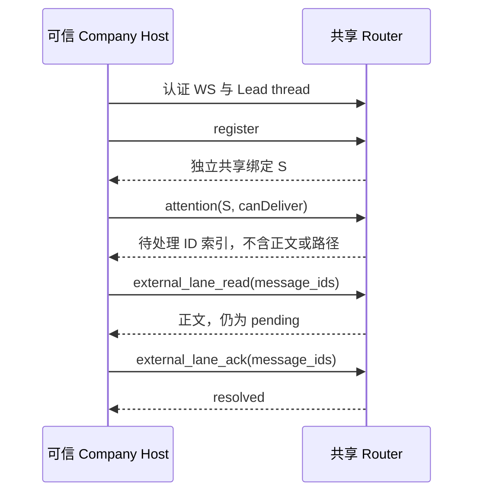

# 原生 Company Lead 的共享接入

共享 Router 接收由可信 Company Host 发起的固定 Lead 通信。它不创建或运行 Company 模型，也不接管 Company 私有绑定；现有 Claude、Codex、DSH、ZCode 入口保持不变。

## 术语表

| 名称 | 含义 |
|---|---|
| L | Company 私有 Router 的 Lead 绑定 |
| S | 共享 Router 的 `native-codex` 绑定；ID 和代次独立于 L |
| permit | 可信启动记录，固定 token、Host ID、Lead 地址与模型声明 |

## 启动配置

既有 Router config 可增加 `nativeHostsFile`，与 `zcode.driver` 并存。配置路径仍由 `LANE_ROUTER_CONFIG` 或 dataRoot 的 `config.json` 决定。许可路径为绝对路径时直接使用；相对路径相对于 dataRoot，而非 config 文件目录。

```json
{"nativeHostsFile":"private/native-hosts.json"}
```

私有许可文件是 JSON 数组，每项含 `token`、`hostInstanceId`、`address`、`slot:"lead"`、非空 `roleDescription`、非空 `model`。可信部署方装配准确值，不向模型、TUI 环境、Git、日志或对话提供 token。此接口不生成许可、不热更新许可、不新增 OS 用户或 Windows ACL 准入规则。

未配置时不启用接收端。配置了文件但文件不可读、JSON 或字段不合法、地址不合法、token/Host ID/address 重复时，启动失败，错误不带文件内容。显式 `runRouterProcess({nativeHosts})` 与 `nativeHostsFile` 同时存在时拒绝启动；空数组表示没有可接入的 Host。config 未知字段仍拒绝。

## 固定 HTTP/WS 合同

token 与完整许可记录不会进入 dashboard 或 discovery。Host ID 不是秘密凭据：共享绑定的 `conversationId` 包含 Host/thread ID，现有 directory、resumeInfo 与 dashboard 仍可能显示该绑定身份；不应把许可保密理解为身份不可见。

仅监听现有 loopback 服务。普通 `/rpc` 不能声明 `native-codex` 身份。

1. Host 用 `Authorization: Bearer <permit token>` 和 `X-Native-Thread-Id` 连接 `/native-host/v1/channel` WebSocket。
2. Host 向 `/native-host/v1/register` POST `{"threadId":"<Lead thread>","previousBinding":{...}}`；首次注册省略 `previousBinding`，只接受从未使用的地址。显式恢复需提供原 S 的全部六字段，严格匹配静态许可、原 Host/thread 复合身份和持久当前活动绑定；错误、inactive、archived、非 native 或不同代次拒绝，不 attach 或增加代次。成功返回 `protocolVersion:1` 和 S，含 `laneId,laneAddress,bindingId,generation,backend,conversationId`。共享 conversation ID 为 Host ID 与 thread ID 的 JSON 二元组。
3. Host 向 `/native-host/v1/call` POST `{"callId":"<unique>","name":"external_lane_send","args":{...}}`。只允许 `external_lane_send`、`external_lane_read`、`external_lane_ack`；调用参数不接受自供 backend 或身份覆盖。

`external_lane_send` 采用 `lane_send` 参数，回执不含存储路径。read/ACK 使用 `message_ids`，read 不 ACK，ACK 只作用于 S 拥有的消息。发送中的相同 `callId` 与相同参数合并；改参数拒绝。完成后不能复用 `callId`，也不能因丢失回执而自动重发。



图仅辅助阅读；未对目标 Markdown 渲染器做验证，编号步骤与文字独立包含合同。

Host 的 `attention` 帧须含 `protocolVersion:1,type:"attention",bindingId,generation,canDeliver`。busy 时通知 deferred；真实 idle 或同一 Host 重连提供重试机会。通知仅含 ID 与 sender，不含正文、摘要或 mailbox 路径。活通道在线时第二连接被拒绝，不踢掉原 socket；原连接关闭后才可重连。不同 thread/Host 不继承旧许可；新进程不自动恢复 S，必须显式携带原 `previousBinding`。Company 产品侧仍须核旧 Host 已退出、L、当前 principal 和 Lead 重新准入，这不是共享接口对 Employee 的授权，也不由共享 Router 管理 Company PID。

## 数据版本与运行边界

schema 9 同时允许五种 backend。准确主线 ZCode v8 与准确 Company native v8 迁移前核实际表、约束和索引；未知形态拒绝。事务内保留全部记录、ID、代次与原始 startup/cwd，重建 binding 索引并核外键。不能仅修改 `user_version` 冒充迁移。

`native-codex` 由 Host 管理，`lane-router-lane open` 和普通恢复不启动它。共享端支持 Lead 首次接入、同活 Host 重连及原静态许可下精确 S 的显式恢复；恢复身份由 Company 非秘密记录保存并传入可信配置。共享接收端的合成冷重启验证不代表真实 Company 冷恢复已验收。不支持 Employee 或许可轮换。

升级必须由运行使用者确定维护时段，先停写再取得一致 DB/mailbox 与完整旧构建。无新写入时失败可恢复完整旧构建及一致快照；有新写入时保存新状态并前向修复，不能只降级 dist、恢复旧 DB 或删除 native 记录。此文档不授权重启或数据读取。

合成验证入口：`npm test -- tests/process/native-shared-integration.test.ts tests/router/native-schema-migration.test.ts`。这些测试不证明真实 Company MCP 装配、共享生产运行或模型通信。
